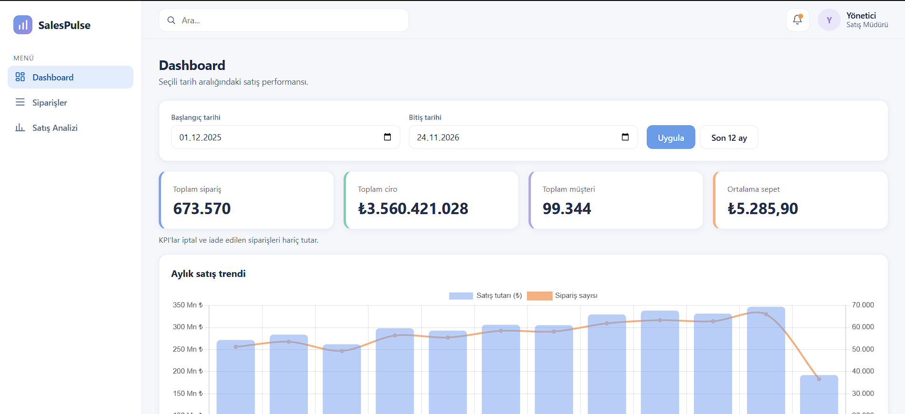
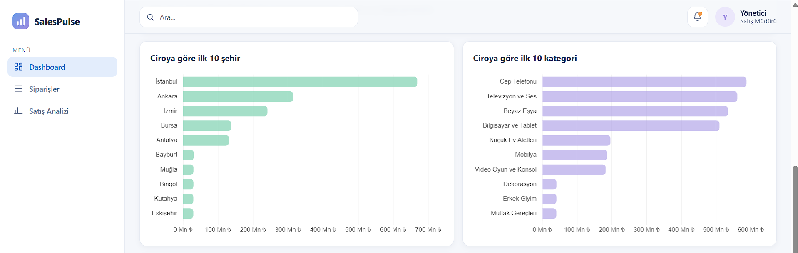
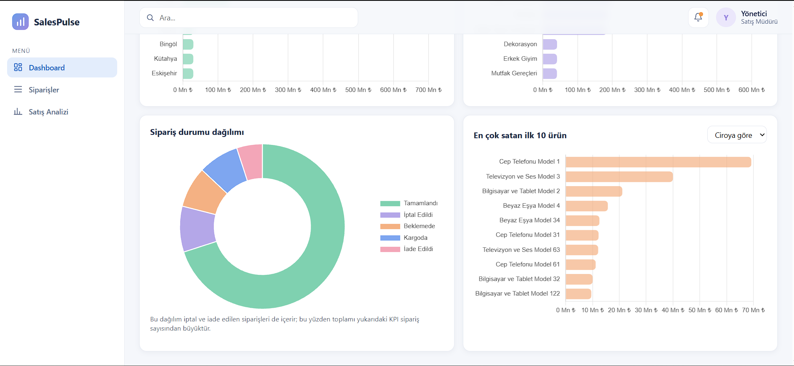
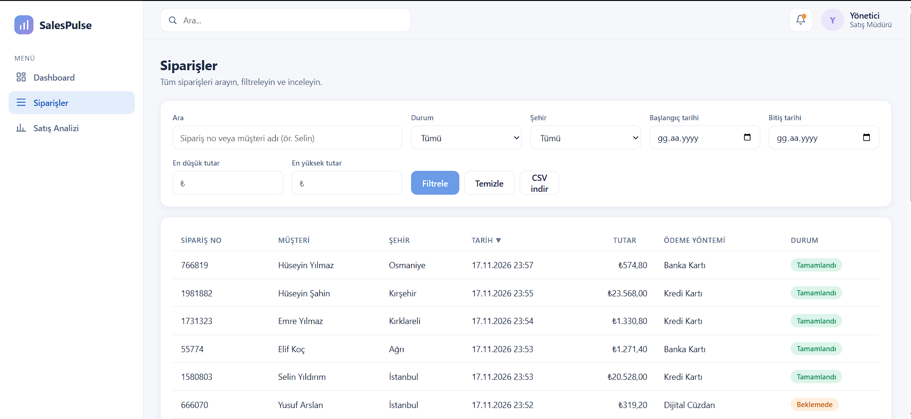
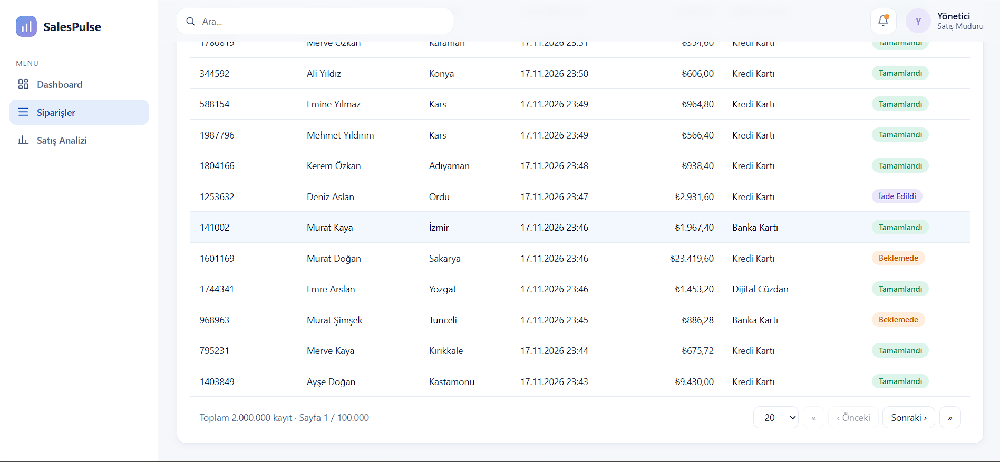
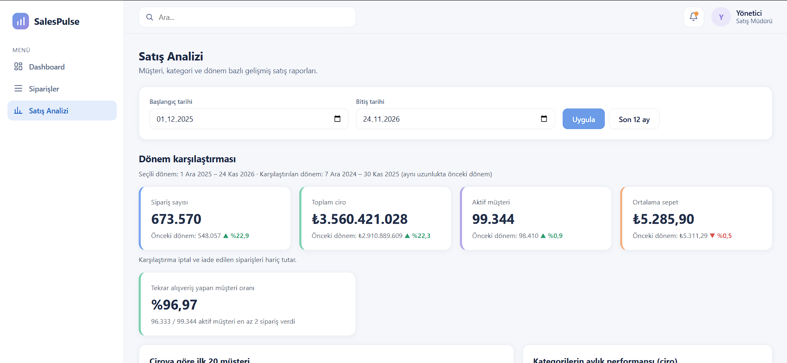
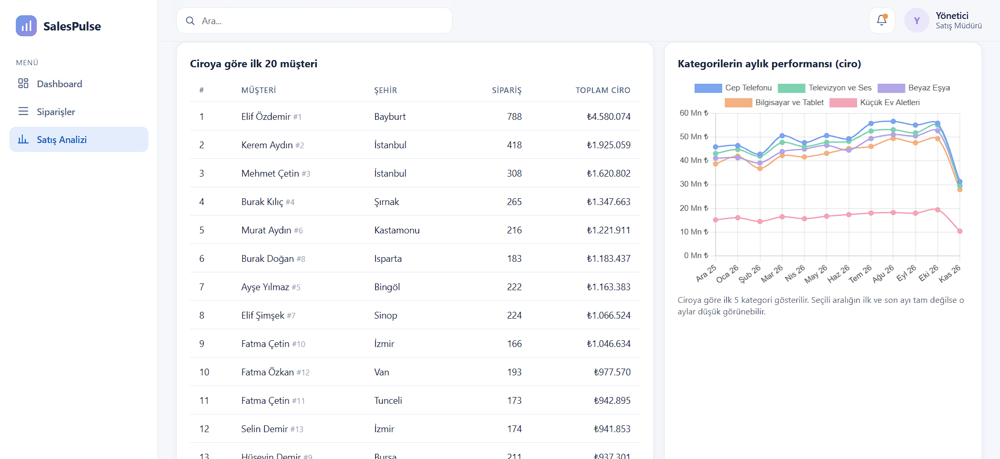
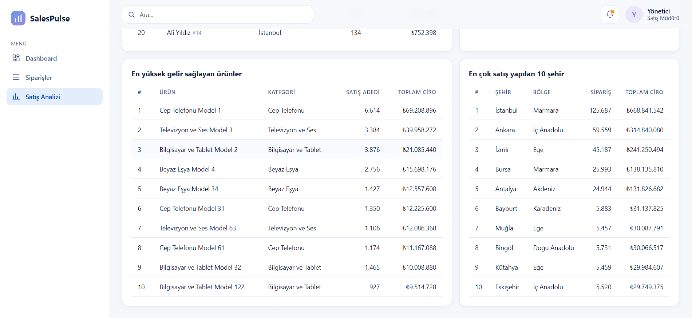
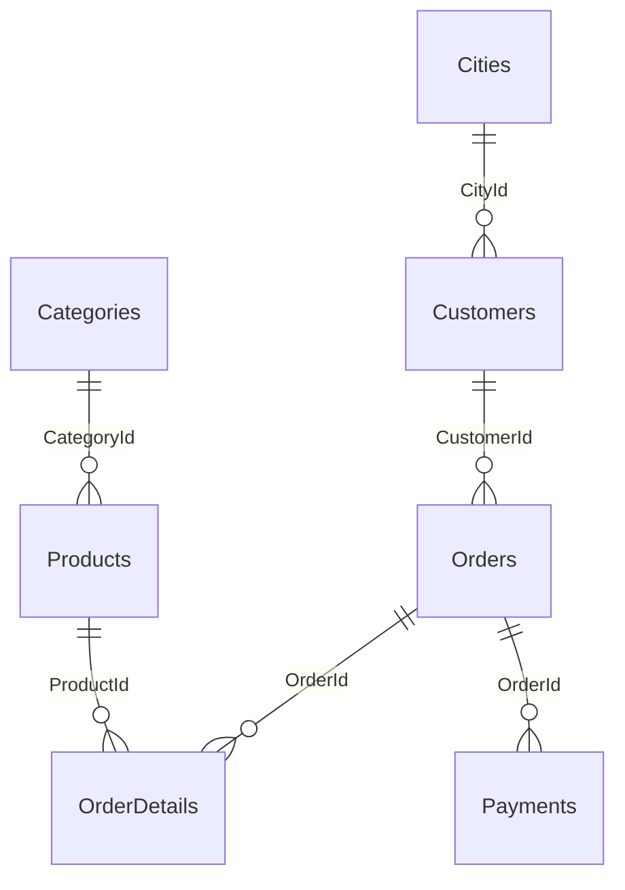

# SalesPulse – E-Ticaret Büyük Veri Analitiği

2 milyon+ siparişlik bir e-ticaret veri setini analiz eden yönetim paneli. Raporların tamamı canlı SQL Server sorgularından üretilir; filtreleme, toplama, sıralama ve sayfalama SQL tarafında yapılır (veri C#'a çekilip GroupBy ile raporlanmaz).

M&Y Yazılım Eğitim Akademi – 7. Proje (Dapper Case).

**Teknolojiler:** ASP.NET Core MVC (.NET 9), Dapper, SQL Server, Chart.js 4.4.1, vanilla JavaScript

## Ekran görüntüleri

### Dashboard





### Orders Explorer




### Sales Intelligence





## Sayfalar

- **Dashboard** (açılış sayfası): toplam sipariş, toplam ciro, toplam müşteri ve ortalama sepet KPI kartları; aylık satış trendi, kategori performansı, şehir dağılımı, sipariş durumları ve en çok satan ürünler (adede / ciroya göre). Sayfa genelinde tarih aralığı filtresi vardır; seçim KPI'ları ve tüm grafikleri veritabanından yeniden hesaplar.
- **Orders Explorer**: sipariş no / müşteri araması; tarih, şehir, durum ve tutar filtreleri; kolon sıralama; sunucu taraflı sayfalama (OFFSET/FETCH); sipariş detay penceresi; sınırlı CSV dışa aktarma.
- **Sales Intelligence**: en yüksek ciro yapan 20 müşteri, en çok satış yapılan şehirler, kategorilerin aylık performansı, en yüksek gelirli ürünler, tekrar alışveriş yapan müşteri oranı ve tarih aralığı karşılaştırması.

## Mimari

```
Web  →  Application  →  Domain
Infrastructure  →  Application
```

- `src/SalesPulse.Web`: MVC controller'lar, view'lar, JavaScript/CSS, `Program.cs` (servis kayıtları)
- `src/SalesPulse.Application`: servisler ve arayüzler
- `src/SalesPulse.Domain`: modeller
- `src/SalesPulse.Infrastructure`: Dapper ile veri erişimi (`IDbConnectionFactory`, `AddInfrastructure(connectionString)`)

Veri erişimi `async/await` ve parametrik Dapper sorgularıyla, stored procedure'ler üzerinden yapılır. Tarih aralığında bitiş tarihi SQL'de hariçtir (servis bitişe +1 gün ekler). Ön yüzde `fetch` ile veri çekilir, eski isteklerin sonucu `requestId` ile yok sayılır, grafikler yeniden çizilirken `destroy` edilir.

## Veritabanı

### Tablo ilişkileri



Şemada 6 foreign key vardır: `Customers→Cities`, `Orders→Customers`, `OrderDetails→Orders`, `OrderDetails→Products`, `Products→Categories`, `Payments→Orders`. Uygulamadaki veride her siparişin tam 1 ödemesi vardır.

### Hacimler

| Tablo | Satır |
|---|---|
| Orders | 2.000.000 |
| OrderDetails | 3.500.000 |
| Payments | 2.000.000 |
| Customers | 100.000 |
| Products | 5.000 |
| Cities | 81 |
| Categories | 30 |

### Stored procedure'ler (14)

`usp_GetDashboardKpis`, `usp_GetMonthlySalesTrend`, `usp_GetTopCities`, `usp_GetTopCategories`, `usp_GetOrderStatusDistribution`, `usp_GetTopProducts`, `usp_GetTopCustomers`, `usp_GetCategoryMonthlyPerformance`, `usp_GetRepeatCustomerRate`, `usp_GetDateRangeComparison`, `usp_GetOrders`, `usp_GetOrderDetail`, `usp_GetCities`, `usp_ExportOrders`

### İndeksler (7)

| İndeks | Tablo | Anahtar kolonlar | INCLUDE |
|---|---|---|---|
| `IX_Customers_FullName` | Customers | FullName | CityId |
| `IX_OrderDetails_OrderId` | OrderDetails | OrderId | ProductId, Quantity, UnitPrice |
| `IX_Orders_CustomerId_OrderDate` | Orders | CustomerId, OrderDate DESC | Status, TotalAmount |
| `IX_Orders_OrderDate` | Orders | OrderDate | TotalAmount |
| `IX_Orders_Status_OrderDate` | Orders | Status, OrderDate | CustomerId, TotalAmount |
| `IX_Orders_TotalAmount` | Orders | TotalAmount DESC, OrderId DESC | OrderDate, CustomerId, Status |
| `IX_Payments_OrderId` | Payments | OrderId | PaymentMethod |

## Kurulum

**Gereksinimler:** Visual Studio 2022, .NET 9 SDK, SQL Server (Express yeterli) ve SSMS.

1. SSMS'te boş bir veritabanı oluştur: `CREATE DATABASE SalesPulseDB;`
2. `database/01_schema.sql` dosyasını SSMS'te aç, ilk satırdaki `USE [...]` veritabanı adının doğru olduğunu kontrol edip çalıştır (tablolar, indeksler, foreign key'ler, stored procedure'ler kurulur).
3. `database/02_seed.sql` dosyasını aç, ilk satırdaki `USE [...]` satırını veritabanı adınla değiştir ve çalıştır. İlk denemede dosyanın başındaki parametreleri küçültmeniz (örn. 1000 / 500 / 20000 / 35000) önerilir. Tam hacimde işlem birkaç dakika sürebilir.
4. `src/SalesPulse.Web/appsettings.json` içindeki `SalesPulseDb` bağlantı cümlesini kontrol et (varsayılan: `Server=.\SQLEXPRESS;Database=SalesPulseDB;Trusted_Connection=True;TrustServerCertificate=True;`). SQL Server örneğin adı farklıysa değiştir.
5. `SalesPulse.sln` dosyasını Visual Studio 2022 ile aç, `SalesPulse.Web` projesini başlangıç projesi yap ve çalıştır (F5). Uygulama Dashboard ile açılır.

## Veri üretimi

`database/02_seed.sql`, tabloları toplu (set-based) `INSERT` ile doldurur. Rastgelelik `CHECKSUM` ile deterministiktir; aynı parametrelerle tekrar çalıştırılırsa aynı veri çıkar. Tablolar boş değilse script hiçbir şey yazmadan durur.

Üretilen veride şunlar bulunur:

- **Şehir yoğunluğu:** büyük iller (İstanbul, Ankara, İzmir…) daha fazla müşteriye sahiptir.
- **Sezon:** Kasım/Aralık yoğun, yaz sakindir; yıllara göre hafif büyüme vardır.
- **Tekrar alışveriş:** bazı müşteriler çok sipariş verir.
- **Sipariş durumları:** Tamamlandı, Kargoda, Beklemede, İptal Edildi, İade Edildi.
- **Ürün satışları:** bazı ürünler çok, bazıları az satar; her sipariş en az 1 kalem içerir, sipariş tutarı kalemlerin toplamıdır.

> **Önemli not:** Aşağıdaki performans ölçümleri, projenin geliştirildiği `SalesPulseDB` veritabanında alınmıştır. Bu veritabanındaki verinin ilk üretiminde kullanılan script saklanmamıştır. `02_seed.sql` bu eksiği kapatmak için sonradan yazılmış örnek bir üreticidir: aynı hacim ve aynı şemayla, ayrı bir boş veritabanında hatasız çalıştığı doğrulanmıştır (2.000.000 sipariş, 3.500.000 kalem; kalemsiz sipariş ve tutarı uyuşmayan ödeme yok). Ancak ürettiği veri, geliştirme veritabanındaki verinin birebir aynısı değildir; bu yüzden ölçüm sayıları kendi veritabanında farklı çıkabilir.

## Performans bulguları

**Ölçüm yöntemi:** `SET STATISTICS TIME ON` ve `SET STATISTICS IO ON`, 3 tekrar ve medyan, Actual Execution Plan (`.sqlplan` dosyaları `docs/` klasöründe). Ölçümler yerel SQL Server 17.0 (RTM) Express üzerinde, plan penceresi kapalıyken alınmıştır. Query 2 ve Query 3'te önbellek çoğunlukla sıcaktı (physical reads çoğu koşuda 0; Query 3'ün ilk indeksiz koşusunda Payments okumaları diskten geldi). Süreler milisaniye çözünürlüğündedir; "<1 ms", ölçümün bu çözünürlüğün altında kaldığı anlamına gelir. Her karşılaştırmada ilgili indeks geçici olarak silinip aynı sorgu yeniden ölçülmüş, sonra indeks geri oluşturulmuştur.

### Query 1: Müşteri adıyla arama (`IX_Customers_FullName`)

`SELECT CustomerId, FullName, CityId FROM dbo.Customers WHERE FullName = N'Zeynep Zorlu'` (bu ad veride yok, sonuç 0 satır)

| | İndeksiz | İndeksli |
|---|---|---|
| Plan | Clustered Index Scan (100.000 satır okunur) | Index Seek |
| Customers logical reads | 2.397 | 3 |
| Süre (3 koşu) | 112 / 84 / 69 ms (medyan ~84 ms) | 30 / 2 / 2 ms (medyan ~2 ms) |
| Plan maliyeti | 1,90 | 0,0033 |

İndeksli ilk koşudaki 30 ms'nin plan derleme maliyeti olması muhtemeldir (planda derleme süresi 9 ms görünür), kesin doğrulanmamıştır. Mutlak süreler küçüktür; indeksin asıl faydası eşleşmeyen veya nadir aramalarda görülür. Veride yalnızca 400 farklı ad-soyad vardır ve her biri 206–297 müşteriye karşılık gelir, bu yüzden sık görülen adlarda fayda sınırlıdır.

### Query 2: Siparişleri tutara göre sıralama (`IX_Orders_TotalAmount`)

`EXEC dbo.usp_GetOrders @SortBy = N'Tutar', @SortDir = N'DESC', @PageNumber = 1, @PageSize = 20` (sayfa sorgusu)

| | İndeksiz | İndeksli |
|---|---|---|
| Plan | Orders tamamı taranıp `Sort` ile sıralanır (~258 MB bellek) | `IX_Orders_TotalAmount` üzerinde sıralı Index Scan, `Top` ile ilk 20 satır |
| Orders logical reads | 13.131 | 3 |
| Süre (3 koşu, medyan) | 3.407 ms | <1 ms (ilk koşu 18 ms, derleme dahil) |
| Plan maliyeti | 204,2 | 0,146 |

İndeks, sorgunun `ORDER BY o.TotalAmount DESC, o.OrderId DESC` ifadesiyle birebir aynı sıralamada (iki kolon da DESC) tanımlıdır, bu yüzden SQL Server ayrıca sıralama yapmaz.

### Query 3: Ödeme yöntemi birleşimi (`IX_Payments_OrderId`)

Query 2 ile aynı çağrı; bu kez `Payments` indeksi silinip ölçülmüştür. İndeksli taraf, Query 2'nin indeksli ölçümüdür.

| | İndeksiz | İndeksli |
|---|---|---|
| Plan | Payments için Clustered Index Scan + Table Spool | Her sipariş için Payments üzerinde Index Seek |
| Payments logical reads | 13.045 (scan count 1) | 63–84 (scan count 20) |
| Worktable logical reads | ~6,18 milyon | yok |
| Süre (3 koşu, medyan) | 12.271 ms | <1 ms |
| Plan maliyeti | 190,0 | 0,146 |

İndeksiz planda SQL Server aynı indeksi `Missing Index` olarak önermiştir (tahmini etki %99,96).

### İlk değerlendirmedeki bir hata

Query 1 için başlangıçta, indeksiz durumda `Orders` tablosunun yoğun okunacağı varsayılmıştı. Ölçümde `Orders` hiç okunmadı (0 logical read); sorgu yalnızca `Customers` tablosunu etkiliyor.

## Veri notları ve bilinen sınırlamalar

- KPI'lar iptal ve iade edilen siparişleri hariç tutar; sipariş durumu dağılımı tüm durumları içerir. Bu yüzden iki toplam farklıdır (örnek bir dönemde 750.878 ve 873.187).
- Geliştirme verisinde CustomerId 1 aykırı bir değerdir (883 sipariş); şehir 6–10 neredeyse eşit dağılır; tekrar alışveriş oranı seçilen tarih aralığına bağlıdır. Veri sentetiktir.
- Müşteri, Şehir, Ödeme Yöntemi ve Durum kolonlarına göre sıralama yavaştır.
- Sipariş sayısı (COUNT) sorgusu indekslerden bağımsız olarak ~190 ms sürer (6.209 logical read).
- `FullName` indeksi sık geçen adlarda sınırlı fayda sağlar (yukarıya bakınız).
- Açılış sayfası Dashboard'dur (case metni belirtmemektedir).
